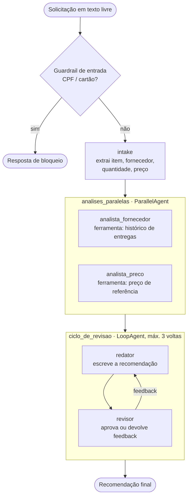

# adk-multiagent-workflows

Exemplo didático de **workflows multiagente com o Google ADK** (Agent Development Kit): fluxo sequencial, etapa em paralelo, ciclo iterativo de revisão, estado compartilhado, guardrails e deploy no Google Cloud.

O caso de uso é a **revisão de uma solicitação de compra**, com **dados 100% fictícios**. Ele existe para mostrar os padrões do ADK, não para resolver um problema de uma empresa real.

## Status

- [x] Código e testes automatizados (19 testes, incluindo o fluxo completo com um modelo falso)
- [ ] Executado com um modelo Gemini real (`adk run` / `adk web`)
- [ ] Deploy no Cloud Run
- [ ] Deploy no Vertex AI Agent Engine

> Os itens abertos serão marcados quando eu os executar de fato. Os testes **não** avaliam a qualidade das respostas de um LLM, só a lógica do fluxo.

## O que o fluxo faz



## Conceitos demonstrados

| Conceito | Onde ver |
|---|---|
| Workflow **sequencial** (`SequentialAgent`) | `purchase_review/agent.py`, `root_agent` |
| Etapa **paralela** (`ParallelAgent`) | `analises_paralelas` |
| Ciclo **iterativo** com condição de saída (`LoopAgent`) | `ciclo_de_revisao` + `aprovar_recomendacao` em `tools.py` |
| **Estado compartilhado** entre agentes (`output_key` e `{chave}` nas instruções) | `agent.py` |
| **Ferramentas** (function tools) | `tools.py` |
| **Guardrail** de entrada (before_agent_callback) | `guardrails.py`, `preparar_e_validar_entrada` |
| **Guardrail** de ferramentas (before_tool_callback) | `guardrails.py`, `limitar_chamadas_ferramenta` |
| Testes sem LLM e **teste de fluxo com modelo falso** | `tests/` |

## Estrutura

```
purchase_review/      pacote do agente (convenção do ADK: root_agent em agent.py)
  agent.py            definição do workflow
  tools.py            ferramentas
  guardrails.py       validações
  data.py             dados fictícios
tests/                testes
examples/             exemplo programático com Runner
docs/                 notas de design
```

## Como rodar

Requer Python 3.10 ou superior e uma chave do Gemini ou um projeto no Vertex AI.

```bash
python -m venv .venv && source .venv/bin/activate
pip install -r requirements.txt
cp .env.example .env        # preencha suas credenciais (o .env não vai para o Git)

adk run purchase_review     # conversa no terminal
adk web                     # interface web de desenvolvimento
```

Exemplo de entrada: `Comprar 500 kg de resina PP da Beta Polímeros a R$ 11,00 o kg`.

O modelo padrão é lido da variável `ADK_MODEL` (padrão `gemini-2.5-flash`). Confirme na documentação do ADK/Vertex quais modelos estão disponíveis para o seu projeto.

## Testes

```bash
pytest
```

- `test_tools.py`: lógica das ferramentas (OTIF, desvio de preço, saída do loop)
- `test_guardrails.py`: bloqueio de dados sensíveis e limite de chamadas
- `test_structure.py`: forma do workflow (ordem, paralelismo, máximo de iterações)
- `test_workflow_fake_llm.py`: roda o fluxo inteiro com um modelo falso e confere o estado da sessão e a saída do ciclo

## Deploy

Comandos da CLI do ADK (conferidos com `adk deploy --help` na versão 2.13; confirme na sua versão):

```bash
# Cloud Run
adk deploy cloud_run --project SEU_PROJETO --region us-central1 --with_ui purchase_review

# Vertex AI Agent Engine
adk deploy agent_engine --project SEU_PROJETO --region us-central1 --display_name purchase-review purchase_review
```

Antes, autentique-se (`gcloud auth login`) e habilite as APIs necessárias no projeto. Não coloque chaves no repositório.

## Limitações e decisões

- **Classes obsoletas:** na versão 2.13 do ADK, `SequentialAgent`, `ParallelAgent` e `LoopAgent` emitem aviso de que serão substituídas por `Workflow`. O exemplo usa as classes atuais porque o `Workflow` ainda não pode ser sub-agente de um `LlmAgent`. Próximo passo: migrar quando for estável.
- **Dados fictícios e em memória**: as ferramentas leem `data.py`. Em um caso real, seriam consultas a um banco ou API.
- **Guardrail de entrada simples**: expressões regulares para CPF e cartão. Não substitui um serviço de detecção de dados sensíveis.
- **Sessões em memória** (`InMemorySessionService`): o estado se perde ao reiniciar.
- **Sem avaliação de qualidade do LLM**: um próximo passo natural é um conjunto de avaliação com `adk eval`.

## Licença

MIT. Veja `LICENSE`.
